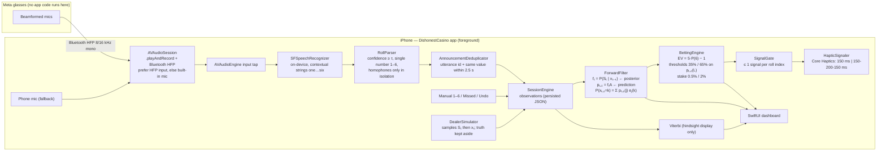

# Architecture

## Block diagram

## Inference (what is computed after every roll)

State order (F, L). π = (0.8, 0.2). A = [[0.95, 0.05], [0.10, 0.90]]. e_F(k) = 1/6, e_L(6) = 0.5, e_L(1–5) = 0.1.

| Quantity | Formula | Meaning | Used for |
|---|---|---|---|
| Prior for roll t | pₜ = fₜ₋₁A (p₁ = π) | belief about die t before seeing it | intermediate |
| **Filtered posterior** | fₜ(i) = pₜ(i)eᵢ(xₜ) / cₜ | P(die t is loaded \| x₁..ₜ) | display ("NOW") |
| **One-step prediction** | pₜ₊₁ = fₜA | P(die t+1 is loaded \| x₁..ₜ) | **betting** |
| Predictive distribution | P(xₜ₊₁=k) = Σⱼ pₜ₊₁(j)eⱼ(k) | next-face probabilities | **betting** |
| Evidence | log P(x₁..ₜ) = Σ log cₜ | model fit | display / tests |

**Numerical stability.** The recursion is normalized at every step (the scaled forward algorithm), so every quantity stays in [0, 1] whatever the sequence length. The log-likelihood is accumulated separately. The tests run 200,000 rolls with no NaN or underflow, and a 5,000-roll sequence where an unscaled α would underflow to 0.

**Missing observations.** A missed roll uses eᵢ(nil) = 1 for both states, which marginalizes the face out. The update reduces to a pure transition step, so the forecast still advances one roll. The tests confirm this equals brute-force marginalization, and that a long run of missed rolls converges to the stationary P(L) = 1/3.

**Viterbi** returns argmax P(S₁..ₜ \| x₁..ₜ). It uses future rolls to relabel the past, so it is not available at decision time. The app shows it only as a labelled "hindsight" row.

## Betting decision

EV per $1 on six at 4:1 net = 4·P(6) − 1·(1 − P(6)) = 5·P(6) − 1. Break-even is P(6) = 0.2.

| Condition (on the prediction pₜ₊₁(L)) | Action | Phone vibration | Stake |
|---|---|---|---|
| EV ≤ 0 **or** pₜ₊₁(L) < 35% | HOLD | none | 0 |
| EV > 0 and 35% ≤ pₜ₊₁(L) < 65% | SMALL | 1 × 150 ms | 0.5% of bankroll |
| EV > 0 and pₜ₊₁(L) ≥ 65% | BIG | 150 ms, 200 ms gap, 150 ms | 2% of bankroll |

Bets are settled when the next observation arrives: +4·stake on a six, −stake otherwise, and void (0) if the roll was missed. The `SignalGate` vibrates at most once per roll index. Re-renders, duplicate recognizer callbacks, undo and app restore cannot re-trigger a signal.

### Limitations of the fixed thresholds

1. **The EV clause never binds under this model.** P(6) = 1/6 + P(L)/3, so EV > 0 ⇔ P(next L) > 10%. The lowest reachable P(next L) is the fixed point of an endless run of non-sixes: 0.4q² − 0.51q + 0.05 = 0, so q\* ≈ 10.70%, giving P(6) ≈ 20.23% and EV ≈ +0.012. This is tested in the `evFloor` check. Every roll therefore has positive EV, and the 35% threshold is what makes the app hold. It gives up bets with small positive EV for the sake of a quieter signal.
2. **Thresholds are on the wrong variable for money.** Profit depends on P(6), not directly on P(L). The thresholds only work because P(6) is a monotone function of P(L) for these emissions.
3. **They ignore uncertainty in the parameters.** If the real dealer's loaded die is less biased, or switches more often, the same 65% buys a smaller edge than the model claims.
4. **Two discrete stake sizes** ignore how large the edge is. EV +0.45 and EV +1.1 get the same treatment within a band.
5. **They're not tied to a utility function.** The 0.5% and 2% caps are risk-management choices, not optimal ones.

### A more principled alternative (implemented as an option)

Maximize expected **log** bankroll (Kelly). For net odds b = 4 and win probability p = P(6), the optimal fraction is f\* = (bp − (1 − p))/b = EV/b. The app's `kelly` policy stakes min(¼·f\*, 2%) of the bankroll. Fractional Kelly hedges against model error. It signals BIG when the stake is at least 1% and SMALL otherwise. On a 10,000-roll simulation where the dealer follows the model exactly, both policies are profitable (see `docs/hmmcheck-output.txt`). Kelly bets on every roll, because EV is always positive here, so it is far more exposed if the model is wrong. That trade-off is a useful discussion point.

## Reliability features (and where they live)

| Requirement | Implementation |
|---|---|
| Confidence check | `RollParser.minimumConfidence` (default 0.40) on the mean `SFTranscriptionSegment.confidence` of the final result. If no confidence is provided, only utterances of at most 3 words are accepted. |
| Invalid or ambiguous | Rejects numbers outside 1–6 ("seven", "12"), more than one distinct number ("two six"), and homophones ("to", "for") unless spoken alone |
| Same announcement twice | Each utterance UUID is delivered once, and the same value within 2.5 s (configurable) is rejected. Manual entry bypasses this. |
| Missing observations | "Missed roll" button → `roll = nil` → prediction-only update, bet voided |
| Observations vs predictions | `Observation` (ground data, persisted) vs `FilterStep` / `BetRecommendation` (derived, recomputed). Separate NOW and NEXT tiles in the UI. |
| Bluetooth disconnection | `AVAudioSession.routeChangeNotification` (`oldDeviceUnavailable`) → fall back to the phone mic and show a status message. `AVAudioEngineConfigurationChange` → rebuild the tap at the new sample rate. HMM state is untouched. |
| Persistence | `SessionStore` writes the `SessionSnapshot` JSON after every roll. On launch the engine replays it deterministically. |
| Invalid roll | `SessionEngine.append` computes on a copy and throws before mutating anything |
